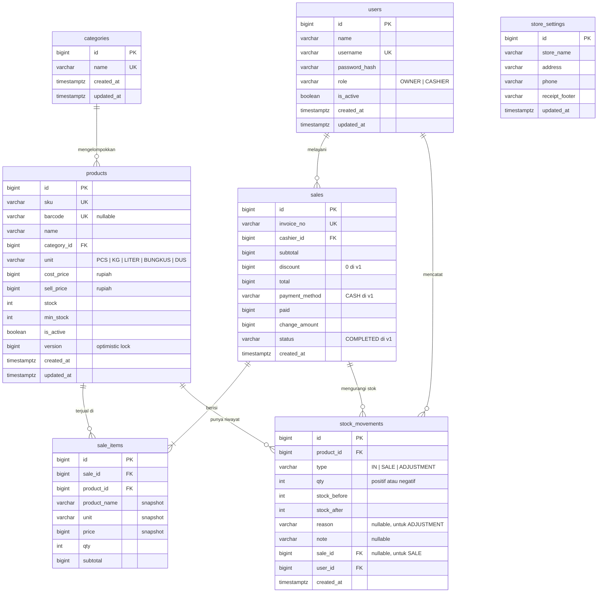

# PRD — ePOS Toko Kelontong (v1)

**Versi dokumen:** 1.2 (model data & status desain)
**Fokus dokumen:** Desain UI/UX frontend dan model data
**Platform:** Web app (Angular + PrimeNG), backend terpisah (Spring Boot REST API)
**Bahasa antarmuka:** Bahasa Indonesia

---

## 1. Ringkasan Produk

ePOS adalah aplikasi kasir berbasis web untuk toko kelontong skala kecil–menengah. Tujuan utamanya adalah membuat proses transaksi di kasir **cepat, minim klik, dan minim salah hitung**, sekaligus membantu pemilik toko memantau stok dan omzet harian.

Versi 1 sengaja dibuat sederhana dan akan dikembangkan bertahap (diskon, retur, member, QRIS, multi-cabang, mode offline).

## 2. Masalah yang Diselesaikan

- Kasir menghitung manual atau dengan kalkulator, rawan salah total dan kembalian.
- Pemilik tidak tahu barang mana yang hampir habis sampai pelanggan menanyakannya.
- Tidak ada catatan omzet harian yang rapi.
- Harga barang sering berubah dan kasir lupa harga terbaru.

## 3. Pengguna (Persona)

### 3.1 Kasir — "Rina", 22 tahun

- Berdiri di meja kasir, sering melayani antrean saat jam ramai.
- Menggunakan scanner barcode USB dan keyboard; mouse jarang dipakai saat ramai.
- Kebutuhan: cari barang cepat, total terlihat jelas, kembalian langsung terhitung, struk tercetak.
- Tidak butuh akses ke harga modal atau laporan.

### 3.2 Pemilik Toko — "Pak Budi", 45 tahun

- Mengecek toko di sore/malam hari, kadang dari tablet.
- Kebutuhan: tambah/ubah produk dan harga, catat stok masuk, lihat omzet hari ini dan barang yang hampir habis.
- Literasi teknologi menengah: butuh antarmuka jelas, tidak penuh istilah teknis.

## 4. Tujuan & Ukuran Keberhasilan

| Tujuan           | Indikator                                                        |
| ---------------- | ---------------------------------------------------------------- |
| Transaksi cepat  | 1 transaksi 5 item selesai < 30 detik tanpa mouse                |
| Minim kesalahan  | Total, kembalian, dan stok dihitung sistem; validasi uang kurang |
| Stok terkontrol  | Barang di bawah stok minimum terlihat di dashboard               |
| Mudah dipelajari | Kasir baru bisa bertransaksi tanpa pelatihan panjang             |

## 5. Ruang Lingkup v1

**Termasuk:**

- Login dengan role (Pemilik, Kasir)
- Layar Kasir (POS): cari/scan barang, keranjang, pembayaran tunai, struk
- Manajemen Produk & Kategori
- Stok Masuk & Penyesuaian Stok
- Riwayat Transaksi & detail struk
- Dashboard ringkas (omzet hari ini, jumlah transaksi, stok menipis)

**Tidak termasuk (roadmap):**

- Diskon per item, retur/void transaksi (v2)
- Supplier & pembelian, laporan laba (v2)
- Member & poin, QRIS/non-tunai, export Excel/PDF (v3)
- Multi-cabang, mode offline (v4)

> Catatan untuk desain: sisakan ruang/pola yang memungkinkan fitur roadmap ditambahkan tanpa merombak layout (misalnya area metode pembayaran bisa menampung opsi selain tunai).

## 6. Hak Akses

| Fitur                    | Pemilik | Kasir                          |
| ------------------------ | ------- | ------------------------------ |
| Layar Kasir              | ✓       | ✓                              |
| Riwayat Transaksi        | Semua   | Hanya milik sendiri, hari ini  |
| Produk & Kategori        | Kelola  | Lihat saja (tanpa harga modal) |
| Stok Masuk / Penyesuaian | ✓       | —                              |
| Dashboard                | ✓       | —                              |

Menu yang tidak diizinkan **disembunyikan**, bukan sekadar dinonaktifkan.

## 7. Arahan Desain Visual

- **Karakter:** bersih, fungsional, tegas, ramah. Terasa seperti alat kerja, bukan aplikasi hiburan.
- **Kepadatan:** Layar Kasir memakai elemen besar dan kontras tinggi; halaman admin (produk, laporan) boleh lebih padat.
- **Warna:** satu warna utama yang tegas untuk aksi utama (tombol Bayar), warna netral untuk latar, serta warna semantik: hijau (sukses/kembalian), kuning/oranye (stok menipis), merah (error/uang kurang/hapus).
- **Tipografi:** sans-serif yang sangat terbaca. Angka nominal memakai angka tabular (lebar sama) agar kolom harga rata.
- **Mode:** mendukung terang dan gelap.
- **Ikon:** konsisten, garis sederhana.
- **Format angka:** Rupiah tanpa desimal, pemisah ribuan titik — contoh `Rp 125.500`.
- **Format tanggal:** `16 Sep 2026, 14:32`.

### Target layar & perangkat

Aplikasi responsif dan bisa dibuka di laptop, tablet, dan HP. Ukuran acuan:

- **Laptop/desktop:** 1366×768 dan 1920×1080
- **Tablet:** 1024×768 (landscape)
- **HP:** 390×844

Tidak semua layar diprioritaskan sama di setiap perangkat, disesuaikan dengan siapa yang memakainya:

| Layar                    | Laptop    | Tablet        | HP                  |
| ------------------------ | --------- | ------------- | ------------------- |
| Login                    | ✓         | ✓             | ✓                   |
| Kasir (POS)              | **Utama** | ✓ (landscape) | Ditunda ke v2       |
| Dashboard                | ✓         | ✓             | **Utama (Pemilik)** |
| Daftar Produk & Kategori | ✓         | ✓             | ✓                   |
| Stok Masuk & Penyesuaian | ✓         | ✓             | ✓                   |
| Riwayat Transaksi        | ✓         | ✓             | ✓                   |

Alasan: kasir bekerja di meja kasir dengan laptop/tablet dan scanner barcode, sedangkan pemilik paling sering memantau toko dari HP.

### Pola responsif

- **Tablet:** layout mengikuti laptop dengan sidebar yang diciutkan menjadi ikon. Layar Kasir tetap dua kolom, proporsi disesuaikan.
- **HP:**
  - Sidebar diganti menu navigasi bawah (bottom navigation) berisi menu utama sesuai role
  - Tabel data berubah menjadi daftar kartu
  - Form tampil satu kolom, drawer/modal tampil layar penuh atau bottom sheet
  - Toolbar filter dilipat ke tombol "Filter" yang membuka bottom sheet
  - Tombol aksi utama (misalnya "Tambah Produk") menjadi tombol mengambang atau menempel di bawah
  - Target sentuh minimal 44px
- Jika Kasir membuka aplikasi dari HP di v1, tampilkan pesan ramah bahwa Layar Kasir tersedia di laptop atau tablet.

## 8. Struktur Navigasi

Sidebar kiri yang bisa diciutkan, header atas berisi nama toko, nama pengguna, role, dan tombol keluar.

```
- Dashboard            (Pemilik)
- Kasir
- Transaksi
- Produk
    - Daftar Produk
    - Kategori
- Stok                 (Pemilik)
    - Stok Masuk
    - Penyesuaian Stok
```

Untuk Kasir, setelah login langsung diarahkan ke Layar Kasir. Untuk Pemilik, ke Dashboard.

**Navigasi di HP (Pemilik):** menu bawah berisi Dashboard, Transaksi, Produk, Stok, dan Lainnya (Kategori, profil, keluar).

---

## 9. Spesifikasi Layar

### 9.1 Login

**Tujuan:** masuk ke aplikasi.

**Elemen:**

- Logo/nama toko
- Input username, input password (dengan tombol tampilkan/sembunyikan)
- Tombol "Masuk"
- Pesan error di bawah form

**State:** default, loading (tombol menampilkan spinner dan nonaktif), error ("Username atau password salah").

---

### 9.2 Layar Kasir (POS) — **layar paling penting**

**Tujuan:** menyelesaikan transaksi secepat mungkin.

**Layout (desktop):** dua kolom.

**Kolom kiri (± 60%) — Pencarian & Keranjang**

- Input pencarian besar di atas, placeholder: "Scan barcode atau ketik nama barang (F2)". Selalu kembali fokus ke sini setelah item ditambahkan.
- Dropdown hasil pencarian: nama barang, SKU, harga jual, sisa stok. Navigasi dengan panah atas/bawah, Enter untuk menambah.
- Tabel keranjang dengan kolom: No, Nama Barang, Harga, Qty (tombol − / input / +), Subtotal, tombol hapus.
- Item terakhir yang ditambahkan diberi sorotan singkat.

**Kolom kanan (± 40%) — Ringkasan & Pembayaran**

- Nomor invoice sementara dan nama kasir
- Jumlah item
- **TOTAL** dalam ukuran sangat besar
- Tombol "Bayar (F9)" yang dominan
- Tombol sekunder: "Kosongkan Keranjang"

**Modal Pembayaran (muncul setelah Bayar):**

- Total belanja (besar)
- Metode: Tunai (v1 satu-satunya, tetapi tampil sebagai pilihan)
- Input "Uang Diterima" dengan tombol nominal cepat: Uang Pas, 10.000, 20.000, 50.000, 100.000
- **Kembalian** tampil real-time, hijau jika cukup, merah dengan pesan "Uang kurang Rp X" jika kurang
- Tombol "Selesaikan Transaksi (Enter)", nonaktif jika uang kurang

**Setelah transaksi sukses:**

- Tampilan konfirmasi: centang sukses, nomor invoice, total, dibayar, kembalian
- Tombol "Cetak Struk" dan "Transaksi Baru (Enter)"

**Pintasan keyboard:**
| Tombol | Aksi |
|---|---|
| F2 | Fokus ke pencarian |
| F9 | Buka pembayaran |
| Enter | Tambah item / konfirmasi |
| + / − | Ubah qty item terpilih |
| Delete | Hapus item terpilih |
| Esc | Tutup modal |

Tampilkan petunjuk pintasan secara halus di bagian bawah layar.

**State & kasus khusus:**

- Keranjang kosong: ilustrasi sederhana + teks "Scan atau cari barang untuk memulai"
- Barcode tidak ditemukan: notifikasi "Barang dengan barcode 8991234567890 tidak ditemukan"
- Stok tidak cukup: qty tidak bisa melebihi stok, tampil peringatan "Stok Minyak Goreng 2 L tersisa 3"
- Stok habis: item tampil di hasil pencarian dengan label "Habis" dan tidak bisa ditambahkan
- Gagal simpan transaksi (koneksi/server): pesan error jelas, keranjang **tidak hilang**, tombol coba lagi
- Loading saat menyimpan transaksi: tombol menampilkan spinner, cegah klik ganda

---

### 9.3 Struk (tampilan cetak)

Format lebar printer thermal 58 mm dan 80 mm.

**Isi:** nama toko, alamat, no. telepon, nomor invoice, tanggal & jam, nama kasir, garis pemisah, daftar item (nama; qty × harga; subtotal), garis pemisah, total, tunai, kembalian, ucapan "Terima kasih, selamat belanja kembali".

---

### 9.4 Dashboard (Pemilik)

**Kartu ringkasan (baris atas):**

- Omzet hari ini
- Jumlah transaksi hari ini
- Rata-rata nilai transaksi
- Jumlah produk stok menipis

**Konten:**

- Grafik batang penjualan per jam hari ini
- Tabel "Stok Menipis": nama barang, stok saat ini, stok minimum, tombol "Tambah Stok" (menuju Stok Masuk dengan barang terpilih)
- Tabel "5 Barang Terlaris Hari Ini": nama, qty terjual, total

**State:** belum ada transaksi hari ini → kartu bernilai 0 dan pesan ramah, bukan grafik kosong yang membingungkan.

---

### 9.5 Daftar Produk

**Toolbar:** pencarian (nama/SKU/barcode), filter kategori, filter status (Aktif/Nonaktif/Stok Menipis), tombol "Tambah Produk".

**Tabel:** SKU, Nama, Kategori, Harga Jual, Harga Modal (Pemilik saja), Stok (badge oranye jika menipis, merah jika habis), Status, Aksi (Edit, Nonaktifkan).

Paginasi di bawah. Mendukung pengurutan per kolom.

**Form Tambah/Edit Produk (drawer samping atau modal):**

- Nama barang*, SKU*, Barcode (opsional, dengan ikon scan), Kategori*, Satuan* (pcs, kg, liter, bungkus, dus)
- Harga Modal*, Harga Jual* — tampilkan margin otomatis ("Margin Rp 1.500 / 12%"); peringatan jika harga jual di bawah modal
- Stok Awal (hanya saat tambah), Stok Minimum\*
- Toggle Aktif
- Validasi inline per field

**State:** kosong ("Belum ada produk. Tambahkan produk pertama Anda"), hasil pencarian kosong, loading (skeleton tabel).

---

### 9.6 Kategori

Tabel sederhana: Nama Kategori, Jumlah Produk, Aksi (Edit, Hapus). Tambah/edit lewat modal kecil. Hapus diblokir jika kategori masih memiliki produk, dengan penjelasan.

---

### 9.7 Stok Masuk (Pemilik)

- Pilih/scan barang, input jumlah, catatan (misal "Belanja grosir 16 Sep")
- Bisa menambahkan beberapa barang dalam satu kali input (daftar sementara)
- Tampilkan stok sebelum → sesudah untuk tiap barang
- Tombol "Simpan Stok Masuk"
- Di bawahnya: riwayat stok masuk terbaru

### 9.8 Penyesuaian Stok (Pemilik)

- Pilih barang, tampil stok sistem saat ini
- Input stok fisik hasil hitung; selisih dihitung otomatis (+/−)
- Alasan wajib: Rusak, Kedaluwarsa, Hilang, Salah Hitung, Lainnya
- Konfirmasi sebelum simpan

---

### 9.9 Riwayat Transaksi

**Filter:** rentang tanggal (default hari ini), kasir (Pemilik saja), pencarian nomor invoice.

**Ringkasan di atas tabel:** total omzet dan jumlah transaksi sesuai filter.

**Tabel:** No. Invoice, Tanggal & Jam, Kasir, Jumlah Item, Total, Aksi (Lihat).

**Detail Transaksi (drawer/modal):** tampilan menyerupai struk dengan tombol "Cetak Ulang".

---

## 10. Komponen yang Dipakai Ulang

- Tombol (primer, sekunder, bahaya, ikon) dengan state loading & nonaktif
- Input teks, input angka Rupiah (otomatis format ribuan), input qty stepper, dropdown, date range picker
- Tabel data dengan paginasi, sortir, skeleton loading
- Badge status stok (Aman / Menipis / Habis) dan status produk (Aktif / Nonaktif)
- Kartu statistik
- Modal, drawer samping, dialog konfirmasi
- Toast notifikasi (sukses, peringatan, error)
- Empty state dengan ilustrasi ringan dan ajakan tindakan

## 11. Aksesibilitas & Kenyamanan

- Semua alur di Layar Kasir bisa diselesaikan hanya dengan keyboard
- Fokus keyboard terlihat jelas
- Kontras teks memenuhi WCAG AA
- Warna tidak menjadi satu-satunya penanda status (selalu disertai teks/ikon)
- Target klik minimal 40px di Layar Kasir (nyaman untuk layar sentuh)

## 12. Contoh Data untuk Mockup

**Toko:** Toko Berkah Jaya — Jl. Kaliurang Km 5, Yogyakarta

| SKU     | Nama               | Kategori        | Harga Jual | Stok | Stok Min |
| ------- | ------------------ | --------------- | ---------- | ---- | -------- |
| BRS-005 | Beras Premium 5 kg | Sembako         | Rp 78.000  | 24   | 10       |
| MYK-002 | Minyak Goreng 2 L  | Sembako         | Rp 36.500  | 3    | 12       |
| GLA-001 | Gula Pasir 1 kg    | Sembako         | Rp 17.500  | 40   | 15       |
| TLR-001 | Telur Ayam 1 kg    | Sembako         | Rp 29.000  | 8    | 10       |
| MIE-001 | Mi Instan Goreng   | Makanan         | Rp 3.500   | 120  | 48       |
| AIR-600 | Air Mineral 600 ml | Minuman         | Rp 4.000   | 0    | 24       |
| SBN-001 | Sabun Mandi Batang | Kebutuhan Rumah | Rp 4.500   | 36   | 12       |
| KPI-001 | Kopi Sachet        | Minuman         | Rp 2.000   | 85   | 30       |

**Contoh keranjang:** Beras Premium 5 kg ×1, Mi Instan Goreng ×5, Telur Ayam 1 kg ×1, Kopi Sachet ×10 → **Total Rp 144.500**, uang diterima Rp 150.000, kembalian **Rp 5.500**.

**Pengguna:** Budi Santoso (Pemilik), Rina Lestari (Kasir).

## 13. Status Desain

Desain v1 **selesai** di Claude Design, dikerjakan satu layar per permintaan dengan urutan berikut (seluruh layar laptop lebih dulu, perangkat lain di akhir):

| Langkah | Layar                                                                             | Perangkat        | Status  |
| ------- | --------------------------------------------------------------------------------- | ---------------- | ------- |
| 1       | Layar Kasir: keranjang terisi — gaya visual dikunci di sini                       | Laptop           | Selesai |
| 2       | Layar Kasir: modal pembayaran, layar sukses, state uang kurang & stok tidak cukup | Laptop           | Selesai |
| 3       | Dashboard                                                                         | Laptop           | Selesai |
| 4       | Daftar Produk + form tambah/edit                                                  | Laptop           | Selesai |
| 5       | Riwayat Transaksi + detail struk                                                  | Laptop           | Selesai |
| 6       | Stok Masuk, Penyesuaian Stok, Kategori                                            | Laptop           | Selesai |
| 7       | Login, struk 58 mm, halaman token desain                                          | Laptop           | Selesai |
| 8a      | Layar Kasir                                                                       | Tablet landscape | Selesai |
| 8b      | Dashboard, Daftar Produk, Riwayat Transaksi, Login                                | HP               | Selesai |

**Belum dibuat (menyusul bila diperlukan):**

- Mockup tablet untuk layar selain Kasir — cukup mengikuti pola responsif di poin 7 saat implementasi.
- Versi HP untuk Stok Masuk, Penyesuaian Stok, dan Kategori — mengikuti pola HP di poin 7.
- Varian mode gelap.
- Layar Kasir versi HP — ditunda ke v2.

---

## 14. Model Data

### 14.1 Diagram Relasi (ERD)



### 14.2 Keterkaitan Tabel dengan Layar

| Tabel             | Dipakai di layar                                                           |
| ----------------- | -------------------------------------------------------------------------- |
| `users`           | Login (9.1), header & nama kasir, filter kasir di Riwayat Transaksi (9.9)  |
| `categories`      | Kategori (9.6), filter & form Produk (9.5)                                 |
| `products`        | Kasir (9.2), Produk (9.5), Stok Menipis di Dashboard (9.4), Stok (9.7–9.8) |
| `stock_movements` | Stok Masuk & riwayatnya (9.7), Penyesuaian Stok (9.8)                      |
| `sales`           | Kasir (9.2), Dashboard (9.4), Riwayat Transaksi (9.9)                      |
| `sale_items`      | Struk (9.3), detail transaksi (9.9), Barang Terlaris di Dashboard (9.4)    |
| `store_settings`  | Header struk (9.3), nama toko di header aplikasi                           |

### 14.3 Nilai Enum

| Kolom                    | Nilai v1                                                    | Disiapkan untuk roadmap |
| ------------------------ | ----------------------------------------------------------- | ----------------------- |
| `users.role`             | `OWNER`, `CASHIER`                                          | —                       |
| `products.unit`          | `PCS`, `KG`, `LITER`, `BUNGKUS`, `DUS`                      | —                       |
| `stock_movements.type`   | `IN`, `SALE`, `ADJUSTMENT`                                  | `RETURN`, `VOID` (v2)   |
| `stock_movements.reason` | `RUSAK`, `KEDALUWARSA`, `HILANG`, `SALAH_HITUNG`, `LAINNYA` | —                       |
| `sales.payment_method`   | `CASH`                                                      | `QRIS`, dll. (v3)       |
| `sales.status`           | `COMPLETED`                                                 | `VOIDED` (v2)           |

Enum disimpan sebagai `varchar` dengan `CHECK` constraint (bukan tipe enum PostgreSQL) agar mudah dipetakan dengan `@Enumerated(EnumType.STRING)` di JPA dan mudah diubah lewat migrasi Flyway.

### 14.4 Aturan Data

- **Uang:** semua nominal disimpan sebagai `bigint` dalam rupiah, tanpa desimal. Tidak memakai tipe floating point.
- **Stok:** `stock_movements` adalah sumber kebenaran dan jejak audit; `products.stock` adalah cache yang selalu diperbarui dalam transaksi yang sama. Stok tidak boleh negatif (`CHECK (stock >= 0)`).
- **Snapshot transaksi:** `sale_items` menyimpan nama, satuan, dan harga saat transaksi, sehingga riwayat tetap akurat walau data produk berubah.
- **Integritas penjualan:** pembuatan transaksi (insert `sales` + `sale_items`, pengurangan stok, pencatatan `stock_movements`) berjalan dalam satu transaksi database dengan penguncian baris produk. Total dihitung ulang di server, bukan diambil dari frontend.
- **Tidak ada hapus fisik:** produk dan pengguna dinonaktifkan lewat `is_active`. Foreign key ke `products` dan `users` memakai `ON DELETE RESTRICT`. Kategori hanya bisa dihapus jika tidak memiliki produk (poin 9.6).
- **Nomor invoice:** unik, format `INV-YYYYMMDD-NNNN` (contoh `INV-20260916-0001`), urutan diulang setiap hari.
- **Zona waktu:** waktu disimpan sebagai `timestamptz`; tampilan dan laporan harian memakai zona Asia/Jakarta.
- **Indeks tambahan:** `products(name)` untuk pencarian di kasir, `sales(created_at)` untuk laporan harian dan riwayat, `stock_movements(product_id, created_at)` untuk riwayat per barang.
